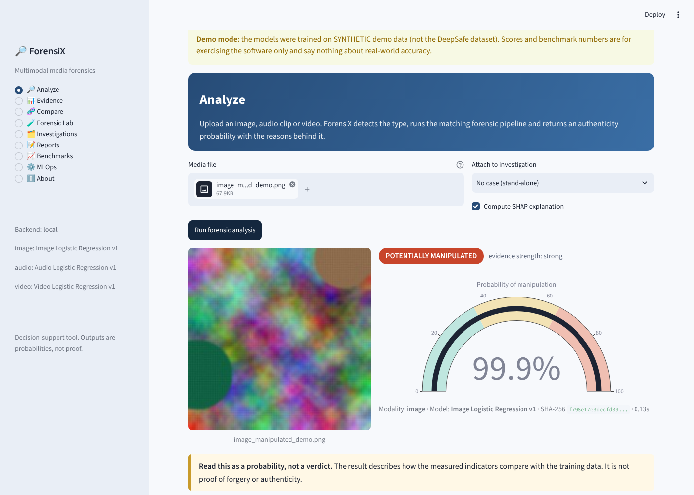
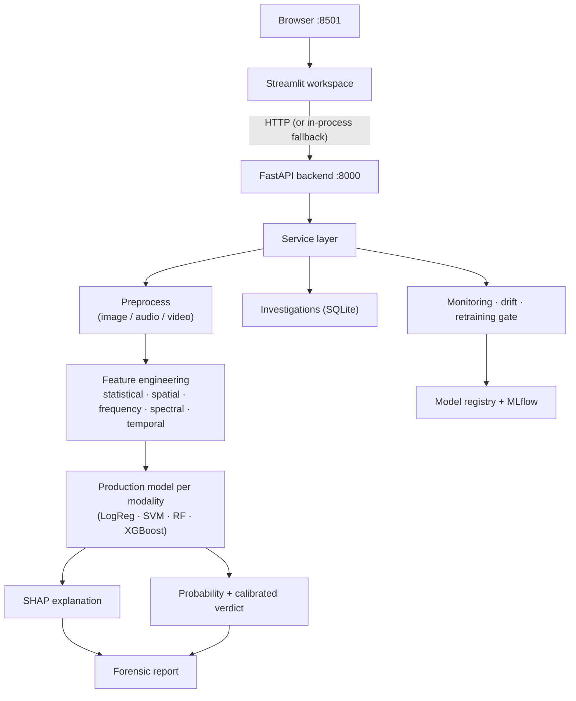
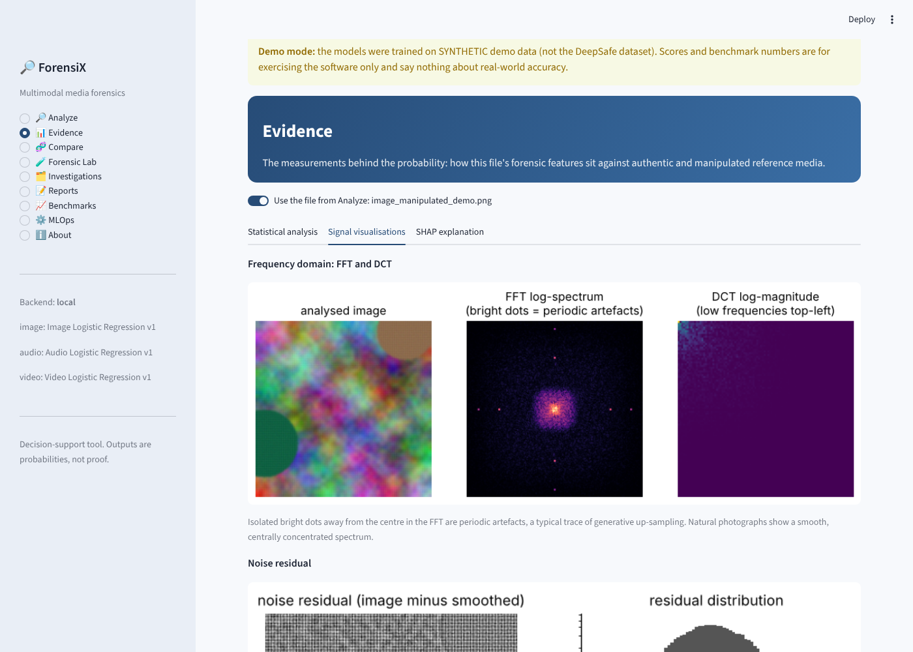
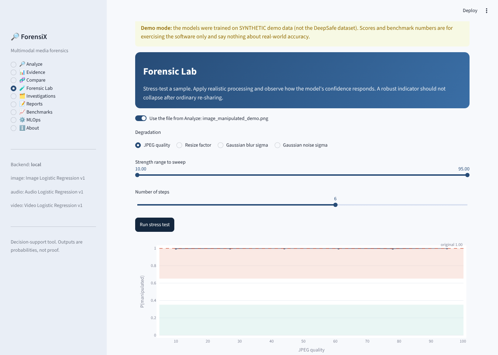
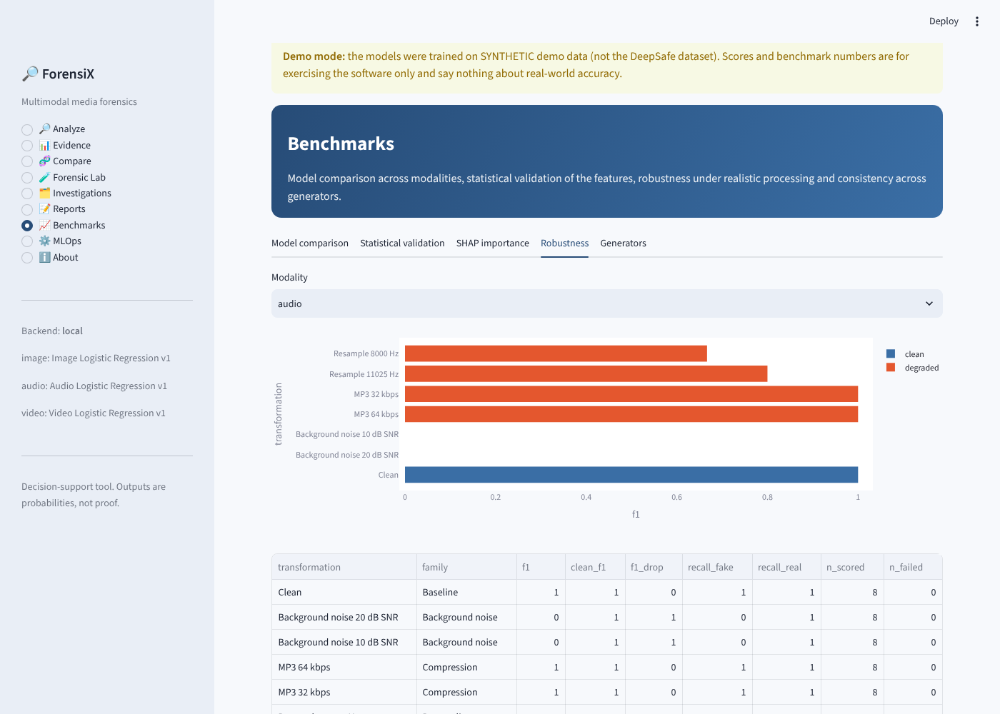
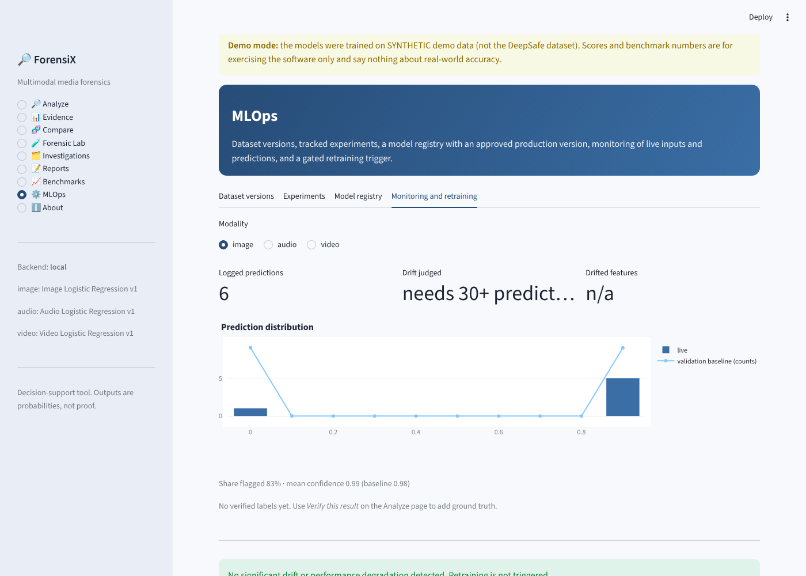

# ForensiX

**Multimodal digital media forensics and authenticity intelligence: images, audio and video, with the evidence shown.**

[](https://github.com/akshatsingh1427/ForensiX/actions)
[](LICENSE)
[](https://www.python.org/downloads/)
[](Dockerfile)
[](https://streamlit.io)
[](https://fastapi.tiangolo.com)

> **Fundamentals of Computing for Data Science Lab (26B16CS318), B.Tech V Semester, JIIT Noida.**
> Rashi Johari (2401030072) · Akshat Singh (2401030075) · Sriza Goel (2401030094)
> Submitted to Dr. Amit Mishra, Dr. Megh Singhal, Dr. Somya Jain.

Most deepfake detectors return a bare *real / fake* label, work on one modality, and are never tested against the
compression and resizing that real media goes through. ForensiX does the opposite: it extracts statistical forensic
features for **images, audio and video**, *proves with hypothesis tests* that those features actually differ between
real and manipulated media, explains **every prediction with SHAP**, **measures how detection degrades** under
realistic processing, checks **consistency across generators**, and writes a **forensic report in calibrated
language** ("potentially manipulated", never "proof of forgery"), all backed by a genuine MLOps lifecycle.

> ### Read this first: what the numbers in this repository mean
> The repository ships **without** the DeepSafe dataset. `make demo` generates a small **synthetic** demo set so the
> whole system can be run offline. On that data every model scores near-perfect F1 because the synthetic "fakes" are
> deliberately easy to separate. **Those scores say nothing about real-world detection accuracy.** The app shows a
> *Demo mode* banner while the demo data is present. To get meaningful results, download the real benchmark
> (`make dataset`, see [docs/DATASET.md](docs/DATASET.md)) and re-run `make pipeline`.

<div align="center">
  
</div>

---

## Architecture



The Streamlit app talks to the FastAPI backend when it is running and **falls back to running the same service layer
in-process** when it is not, so `make app` works on its own.

## Quick start

```bash
git clone https://github.com/akshatsingh1427/ForensiX.git
cd ForensiX
make install          # pip install -r requirements.txt && pip install -e .
make demo             # synthetic data -> full pipeline (about a minute on a laptop)
make start            # API on :8000 and app on :8501
```

| URL | Description |
|-----|-------------|
| http://localhost:8501 | ForensiX web workspace |
| http://localhost:8000/docs | API documentation (Swagger) |
| `make mlflow` → http://localhost:5000 | Experiment tracking UI |

Try the files in [`test_samples/`](test_samples/) (synthetic) in the **Analyze** page. With Docker: `docker compose up --build`.

**Requirements:** Python 3.10+, FFmpeg (for MP3 / H.264 robustness tests; a pure-Python fallback is used if absent).

## The twelve-stage pipeline

| # | Stage | Where | Command |
|---|-------|-------|---------|
| 1 | Data acquisition and dataset construction (unified metadata table, leak-free splits) | `forensix/data/dataset.py` | `make ingest` |
| 2 | Preprocessing (corruption, duplicates, resize, colour space, resample, silence, frame sampling) | `forensix/preprocess/` | `make ingest` |
| 3 | Exploratory data analysis (histograms, box plots, correlations, FFT/DCT, spectrograms, MFCC, frames) | `forensix/eda.py` | `make eda` |
| 4 | Feature engineering (per modality) | `forensix/features/` | `make features` |
| 5 | Statistical analysis (tests, CIs, effect sizes, FDR, outliers, correlation) | `forensix/stats/` | `make stats` |
| 6 | Modelling: Logistic Regression, SVM, Random Forest, XGBoost per modality | `forensix/models/train.py` | `make train` |
| 7 | Explainability with SHAP (global and per-prediction) | `forensix/explain/` | `make explain` |
| 8 | Evaluation: accuracy, precision, recall, F1, ROC AUC, confusion, ROC, PR | `forensix/models/train.py` | `make train` |
| 9 | Robustness testing (clean vs degraded F1) | `forensix/robustness/` | `make robustness` |
| 10 | Source / generator-wise consistency analysis | `forensix/models/generators.py` | `make generators` |
| 11 | Deployment: FastAPI + Streamlit workspace | `api/`, `frontend/` | `make start` |
| 12 | MLOps: dataset versions, MLflow, registry, monitoring, retraining trigger | `forensix/mlops/` | `make monitor` / `make retrain` |

Details for every stage: [docs/METHODOLOGY.md](docs/METHODOLOGY.md).

## Forensic features

| Modality | Feature families (≈ count) |
|----------|---------------------------|
| **Image** (34) | mean, variance, skewness, kurtosis, entropy, RGB statistics · edge density, local variance, Laplacian sharpness · noise-residual statistics and autocorrelation · FFT band energies, spectral slope, periodic-peak strength · DCT high-frequency energy, 8×8 blockiness |
| **Audio** (47) | 13 MFCCs (mean/std) and delta variability · spectral centroid, bandwidth, rolloff, flatness, contrast, flux · zero-crossing rate · RMS energy, dynamic range, noise floor · pitch mean/std/jitter · high-frequency energy ratios |
| **Video** (33) | frame-level visual statistics (mean/std over time) · frame-to-frame differences · brightness and texture change · temporal noise correlation · optical-flow motion magnitude and coherence · motion-compensated warp error |

## The web workspace

| Module | What it does |
|--------|--------------|
| **Analyze** | Upload a file; the modality is detected automatically; returns an authenticity probability, a calibrated verdict, results of all four candidate models and the top SHAP indicators |
| **Evidence** | Statistical context (this file against the real/fake distributions), FFT/DCT, spectrogram and MFCC, temporal anomaly plots, SHAP explanation |
| **Compare** | Two versions of one media item: difference heatmap, SSIM/PSNR (image), waveform/spectrogram difference (audio), per-frame difference (video), confidence change |
| **Forensic Lab** | Apply JPEG, resize, blur, noise, background noise, MP3, resampling, H.264, down-scaling or frame-rate reduction and watch the model's confidence respond |
| **Investigations** | Group analyses into cases with notes, status and a timeline; export a case report |
| **Reports** | A written forensic report (HTML / Markdown) with assessment, probability, model results, indicators, explanation, context and limitations |
| **Benchmarks** | Model comparison, statistical validation, robustness and generator-wise results |
| **MLOps** | Dataset versions, MLflow runs, model registry with promotion, drift / performance monitoring and the retraining trigger |

<div align="center">
  
  
  
  
</div>

<sub>Screenshots were taken on the synthetic demo data.</sub>

## Honest evaluation by design

* **No leakage.** Exact duplicates (MD5) and near-duplicate images (difference hash) are grouped and only the first
  member is kept; splits are stratified by modality and class. Tests assert no content straddles two splits.
* **Selection on validation only.** The best model per modality is chosen on the validation split; the test split is
  reported but never used to choose.
* **Statistics confirm, not assume.** Welch t, Mann-Whitney U and KS tests, Benjamini-Hochberg FDR correction, Cohen's d
  and 95% confidence intervals decide which features genuinely differ.
* **Robustness is the main experiment.** Degraded copies are made from the **test split only** and are never mixed into
  training. Samples that cannot be analysed after a transformation are counted (`n_failed`), not silently dropped.
* **Generators are used only to check consistency**, with Wilson intervals and a low-support flag; ForensiX never tries
  to identify which generator made a file.
* **Calibrated language.** Probability < 35% → *no strong indication of manipulation*; > 65% → *potentially
  manipulated*; in between → *inconclusive*. Every report lists the limitations.
* **Retraining is gated.** A new model is promoted only if it beats the production model on the same untouched test set.

## MLOps

| Capability | Implementation |
|------------|----------------|
| Dataset versioning | `artifacts/dataset_versions.json` (sample counts, preprocessing and feature version, date) + `dvc.yaml` |
| Experiment tracking | MLflow (SQLite backend): model, modality, feature set, hyper-parameters, accuracy / precision / recall / F1 / ROC AUC |
| Model registry | Named versions such as *Image XGBoost v1*, with `staging → production → archived / rejected` and an approved production model |
| Monitoring | Input-feature drift (PSI), prediction and confidence distributions, production F1 / precision / recall from verified labels |
| Retraining trigger | Drift share ≥ 30% of features **or** production F1 > 5 points below baseline → train, compare, promote only if better |

Drift is **never claimed on too little data**: with fewer than `min_samples` logged predictions the monitor reports
"not enough data". See [docs/MLOPS.md](docs/MLOPS.md).

## API reference

```bash
# analyse a file
curl -X POST http://localhost:8000/analyze -F "file=@photo.jpg"

# stress test
curl -X POST http://localhost:8000/lab -F "file=@photo.jpg" -F "kind=jpeg"

# open a case and analyse into it
curl -X POST http://localhost:8000/cases -H "Content-Type: application/json" -d '{"name":"Case A"}'
curl -X POST http://localhost:8000/analyze -F "file=@photo.jpg" -F "case_id=CASE-XXXXXXXX"
```

```json
{
  "modality": "image",
  "probability_manipulated": 0.97,
  "verdict": {"label": "manipulated", "text": "potentially manipulated", "evidence_strength": "strong"},
  "model": {"display": "Image XGBoost v1"},
  "explanation": {"contributions": [{"feature": "fft_hf_peak_z", "direction": "manipulated", "shap": 0.41}]}
}
```

Full endpoint list in [docs/API.md](docs/API.md) or at `/docs`. A small Python client lives in `sdk/forensix_client`:

```python
from forensix_client import ForensiXClient
print(ForensiXClient("http://localhost:8000").analyze("photo.jpg")["verdict"]["text"])
```

## Commands

```bash
make help        # all commands
make demo        # synthetic data + full pipeline (offline)
make dataset     # download and arrange the DeepSafe benchmark (needs internet)
make pipeline    # run every stage on data/raw
make start       # API + app
make test        # pytest
make monitor     # drift / degradation report
make retrain     # retrain if triggered; promote only if better
make mlflow      # experiment tracking UI
```

## Project structure

```
ForensiX/
├── api/                      # FastAPI backend (main.py)
├── frontend/                 # Streamlit workspace
│   ├── app.py
│   ├── backend.py            # HTTP client with in-process fallback
│   └── views/                # analyze, evidence, compare, lab, investigations, reports, benchmarks, mlops
├── forensix/                 # core library
│   ├── data/                 # dataset construction, synthetic demo generator
│   ├── preprocess/           # image / audio / video preprocessing
│   ├── features/             # feature extractors + human-readable catalog
│   ├── stats/                # hypothesis tests, CIs, correlation
│   ├── models/               # training, evaluation, generator-wise analysis
│   ├── explain/              # SHAP (per-sample and global)
│   ├── robustness/           # degradations + clean-vs-degraded benchmark
│   ├── mlops/                # registry, tracking, versioning, monitoring, retraining
│   ├── inference.py  services.py  lab.py  cases.py  report.py  visuals.py  eda.py  pipeline.py
├── sdk/forensix_client/      # Python client for the API
├── config/params.yaml        # every tunable parameter
├── models/                   # versioned trained models (generated)
├── scripts/                  # dataset download, demo data, monitoring, registry CLI
├── tests/                    # 65+ tests (unit, pipeline, API, MLOps)
├── test_samples/             # tiny synthetic files for trying the app
├── docs/                     # methodology, dataset, API, MLOps, ethics
├── dvc.yaml  Dockerfile  docker-compose.yml  Makefile  pyproject.toml  requirements.txt
└── .github/workflows/        # CI and scheduled monitoring
```

## Ethics and limitations

ForensiX is a **detection and defensive** tool; nothing in it is designed to help create deepfakes. Outputs are
probabilities, not proof, and any evidentiary, journalistic or legal use needs review by a qualified human analyst.
Uploaded media is analysed in memory and deleted; only a SHA-256 hash, numeric features and results are retained.
Known limits: reduced reliability on heavily transformed media (quantified by the robustness benchmark), uneven
performance across generators (quantified by the generator analysis), and no coverage of generation methods absent
from the training data. Details: [docs/ETHICS.md](docs/ETHICS.md).

## Contributing

See [CONTRIBUTING.md](CONTRIBUTING.md) and the [Code of Conduct](CODE_OF_CONDUCT.md).

## License

MIT License. See [LICENSE](LICENSE). The **DeepSafe dataset has its own licence terms**; confirm them at its source and
record them in your report before use (see [docs/DATASET.md](docs/DATASET.md)).

## Credits and references

* DeepSafe benchmark: S. Kumar, [github.com/siddharthksah/DeepSafe](https://github.com/siddharthksah/DeepSafe) and the
  [HuggingFace dataset](https://huggingface.co/datasets/siddharthksah/DeepSafe-benchmark).
* Mirsky, Y. and Lee, W. (2021). *The Creation and Detection of Deepfakes: A Survey.* ACM Computing Surveys 54(1). https://doi.org/10.1145/3425780
* Farid, H. (2009). *Image Forgery Detection.* IEEE Signal Processing Magazine 26(2). https://doi.org/10.1109/MSP.2008.931079
* Lundberg, S. M. and Lee, S.-I. (2017). *A Unified Approach to Interpreting Model Predictions.* NeurIPS 30.
* Chen, T. and Guestrin, C. (2016). *XGBoost: A Scalable Tree Boosting System.* KDD. https://doi.org/10.1145/2939672.2939785
* [Streamlit](https://docs.streamlit.io) · [FastAPI](https://fastapi.tiangolo.com) · [MLflow](https://mlflow.org/docs/latest/index.html) · [DVC](https://dvc.org/doc) · [scikit-learn](https://scikit-learn.org)

## Citation

```bibtex
@misc{forensix,
  author = {Johari, Rashi and Singh, Akshat and Goel, Sriza},
  title  = {ForensiX: Multimodal Digital Media Forensics and Authenticity Intelligence},
  year   = {2026},
  note   = {B.Tech V Semester project, Jaypee Institute of Information Technology, Noida}
}
```
