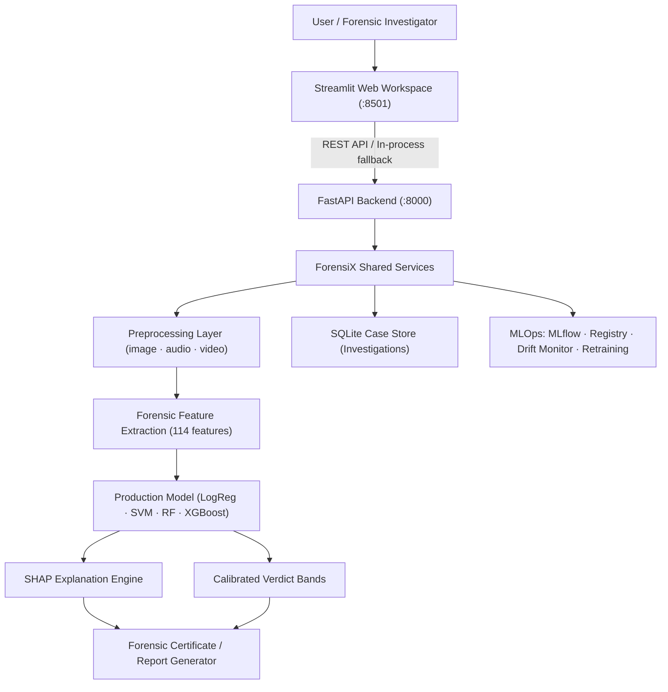

# ForensiX: Multimodal Digital Media Forensics & Authenticity Intelligence

**Course:** Fundamentals of Computing for Data Science Lab (26B16CS318) — B.Tech V Semester  
**Institution:** Jaypee Institute of Information Technology (JIIT), Noida  
**Project Team Members:**
- **Rashi Johari** (2401030072)
- **Akshat Singh** (2401030075)
- **Sriza Goel** (2401030094)

**Supervisors / Faculty Mentors:**
- Dr. Amit Mishra, Dr. Megh Singhal, Dr. Somya Jain

---

## 1. Project Overview & Core Philosophy

Most commercial deepfake detectors suffer from four fatal flaws:
1. **Single Modality:** They only check images, or only audio, or only video.
2. **Black-Box Binary Labels:** They output a simple "Real" or "Fake" without showing *why*.
3. **No Robustness Testing:** They break when images are compressed on WhatsApp/Instagram or resized.
4. **Data Leakage & Bad Science:** Duplicate images leak across train and test sets, inflating test accuracy artificially.

**ForensiX solves this by building a transparent, scientifically honest forensic platform:**
- **Multimodal (Images, Audio, Video):** Extracts physical, spectral, noise, and temporal artifacts across all three media formats.
- **Hypothesis-Driven Statistics:** Uses Welch t-tests, Mann-Whitney U, and Benjamini-Hochberg False Discovery Rate (FDR) control to prove that engineered features truly separate authentic from manipulated media.
- **Explainable (SHAP):** Every prediction is explained using Shapley Additive exPlanations, mapping mathematical values to human-understandable biological and digital indicators.
- **Realistic Robustness Testing:** Stress-tests models on degraded test copies (JPEG compression, Gaussian noise, blur, downsampling, MP3 compression, H.264 video compression).
- **Calibrated Verdict Language:** Uses forensic language bands (<35% authentic, 35–65% inconclusive, >65% potentially manipulated).
- **True MLOps Pipeline:** Includes dataset versioning, MLflow experiment tracking, model registry with promotion stages, Population Stability Index (PSI) drift monitoring, and retraining gates.

---

## 2. System Architecture

ForensiX supports a **dual-mode architecture**:
- **Production Mode:** The Streamlit frontend interacts with the asynchronous FastAPI backend over REST API endpoints (`/analyze`, `/explain`, `/report`, `/mlops`).
- **In-Process Fallback Mode:** If the FastAPI backend is not started, the Streamlit app seamlessly calls the shared service layer (`forensix/services.py`) in-process, guaranteeing high availability and zero downtime.

---

## 3. The 12-Stage Pipeline Workflow

| # | Pipeline Stage | Forensic Activity | Primary Module | CLI Command |
|---|----------------|-------------------|----------------|-------------|
| 1 | **Data Acquisition & Dataset Construction** | Scans raw folders, auto-infers labels/sources, extracts MD5 & perceptual dHash, creates leak-free 70/15/15 stratified splits. | `forensix/data/dataset.py` | `make ingest` |
| 2 | **Multimodal Preprocessing** | Rejects corrupt/silent samples; standardises images (256x256 RGB float [0, 1]), audio (16kHz mono, peak normalisation, 4s chunks), video (128x128 sampled frames). | `forensix/preprocess/` | `make ingest` |
| 3 | **Exploratory Data Analysis (EDA)** | Class-conditional histograms, boxplots, Spearman correlations, 2D FFT power spectrum, audio spectrograms/MFCCs, temporal differences. | `forensix/eda.py` | `make eda` |
| 4 | **Forensic Feature Engineering** | Extracts 34 image, 47 audio, and 33 video features; links each to the human-readable forensic catalog. | `forensix/features/` | `make features` |
| 5 | **Statistical Validation** | Welch t-test, Mann-Whitney U, Kolmogorov-Smirnov, Cohen's d, Benjamini-Hochberg FDR correction (q < 0.05). | `forensix/stats/` | `make stats` |
| 6 | **Multi-Model Training** | Fits Logistic Regression, SVM, Random Forest, and XGBoost per modality. Selects winning model on validation split F1. | `forensix/models/train.py` | `make train` |
| 7 | **Explainability (SHAP)** | Computes TreeExplainer and PermutationExplainer SHAP values to attribute predictions to specific features. | `forensix/explain/` | `make explain` |
| 8 | **Model Evaluation** | Computes Accuracy, Precision, Recall, F1, ROC AUC, PR curves, and confusion matrices on the untouched test split. | `forensix/models/train.py` | `make train` |
| 9 | **Robustness Stress-Testing** | Degrades test sets under JPEG, noise, blur, MP3, downsampling, and H.264 compression; calculates performance degradation. | `forensix/robustness/` | `make robustness` |
| 10 | **Generator-Wise Analysis** | Calculates manipulation recall with Wilson 95% confidence intervals per synthetic generator source. | `forensix/models/generators.py` | `make generators` |
| 11 | **Deployment & Workstation** | Runs FastAPI REST endpoints and Streamlit 8-view forensic workstation. | `api/`, `frontend/` | `make start` |
| 12 | **MLOps & Monitoring** | MLflow logging, staging-to-production model registry, PSI drift monitoring, and test-gated retraining. | `forensix/mlops/` | `make monitor` |

---

## 4. 4.12 Contribution of Team Members

Each member wrote and tested code in a separate part of the system and took part in integration, testing, and documentation.

### Table 4.5: Code contributions

| Member | Modules implemented | Main files |
|---|---|---|
| **Rashi Johari** (2401030072) | Dataset construction, duplicate detection and splits; image, audio and video preprocessing; feature extraction and feature catalogue; exploratory data analysis | `data/`, `preprocess/`, `features/`, `eda.py` |
| **Akshat Singh** (2401030075) | Shared service layer, inference engine and verdict bands, FastAPI backend and client library, Streamlit application, MLOps (tracking, registry, versioning, monitoring, retraining), report builder, case store, tests and CI | `services.py`, `inference.py`, `api/`, `frontend/`, `sdk/`, `mlops/`, `report.py`, `cases.py`, `tests/` |
| **Sriza Goel** (2401030094) | Statistical validation, model training and evaluation, SHAP explanations, robustness transformations and evaluation, generator-wise analysis, forensic lab | `stats/`, `models/`, `explain/`, `robustness/`, `lab.py` |

---

## 5. Rashi Johari's Contribution in Plain English

### The Big Picture
Think of building a machine learning project like cooking a gourmet dish:
- If your raw ingredients are rotten, dirty, or unorganized, no chef (algorithm) can save the dish.
- **Rashi Johari** is the **Data & Forensic Feature Foundation Engineer**. Her job was to inspect, clean, standardize, and mathematically transform raw media files into clean, leak-free tabular data that the models can learn from.

### Rashi's 4 Core Modules & What She Did

#### 1. Dataset Construction, Duplicate Detection & Leak-Free Splits (`forensix/data/`)
- **Auto-Inference (`dataset.py`):** Automatically scans folders and figures out whether a file is authentic or synthetic and which generator made it (e.g., `image/fake/stable_diffusion/x.png` -> label=1, source="stable_diffusion").
- **Deduplication:** Prevents data leakage. Uses exact **MD5 cryptographic hashing** plus **64-bit difference hashing (dHash)** with Hamming distance <= 2 for images to detect duplicates and near-duplicates (like resized or cropped images). Duplicates are marked `status=duplicate` and isolated.
- **Leak-Free 70/15/15 Splits:** Divides data into Train (70%), Validation (15%), and Test (15%) splits stratified by modality and class. Ensures that no sample from a duplicate group ever leaks into the test set.
- **Synthetic Data Generator (`synthetic.py`):** Created the synthetic test-generator so anyone can run the demo pipeline (`make demo`) offline in 60 seconds.

#### 2. Multimodal Preprocessing (`forensix/preprocess/`)
- **Image Preprocessing (`image.py`):** Detects corrupt files, resizes images to uniform 256x256 using area/cubic interpolation, converts color space to RGB, and normalizes pixels to float32 in [0, 1].
- **Audio Preprocessing (`audio.py`):** Validates sound files, rejects silent audio (below -55 dBFS), resamples audio to 16 kHz mono, removes DC offset, peak-normalizes volume to 0.95 (so loudness differences don't trick models), and segments audio into 4-second chunks.
- **Video Preprocessing (`video.py`):** Verifies valid video streams, extracts frames at fixed intervals (every 2nd frame up to 24 frames), resizes them to 128x128, and pairs adjacent frames for temporal analysis.

#### 3. Forensic Feature Extraction & Catalog (`forensix/features/`)
Instead of treating images as random pixels, Rashi extracted **114 domain-specific forensic features**:
- **34 Image Features:** Shannon entropy, gray-level variance/skewness/kurtosis, RGB channel correlation; Laplacian edge sharpness; noise-residual standard deviation and 1-pixel/2-pixel autocorrelation (detects GAN/diffusion upsampling artifacts); 2D Fast Fourier Transform (FFT) radial power slopes and periodic high-frequency peaks; Discrete Cosine Transform (DCT) 8x8 blockiness.
- **47 Audio Features:** 13 MFCC means and standard deviations (vocal tract geometry); spectral centroid, rolloff, flatness, contrast, and flux; zero-crossing rate; pitch mean, standard deviation, and **pitch jitter** (synthetic voices often sound unnaturally flat/smooth); high-frequency energy ratios (>4kHz, >7kHz).
- **33 Video Features:** Frame-to-frame brightness and texture changes; temporal difference jerk; inter-frame noise correlation; optical-flow motion vectors and motion coherence; and motion-compensated warp error (revealing facial warping artifacts).
- **Forensic Catalog (`catalog.py`):** Created a dictionary pairing every single feature with its forensic category (e.g. "Frequency", "Spectral", "Motion") and a human-readable explanation, powering the SHAP explanations and final forensic reports.

#### 4. Exploratory Data Analysis (`forensix/eda.py`)
- Programmed automated statistical visualizations executed strictly on the training set:
  - Class-conditional histograms and box plots for top separating features.
  - Spearman rank correlation heatmaps to reveal redundant features.
  - Mean 2D FFT radial spectra comparing real vs. synthetic images.
  - Audio waveforms, spectrograms, and MFCC heatmaps.
  - Video temporal anomaly plots.
  - Exports `summary.json` containing class distributions and top separating features.

---

## 6. Viva Speaking Points & Guide for Rashi Johari

### Your 1-Minute Elevator Pitch
> *"In ForensiX, I built the entire Data and Forensic Feature Engineering Foundation. I designed the multimodal pipeline that takes raw images, audio, and video, cleans them, rejects corrupt files, and eliminates data leakage using MD5 and perceptual dHash deduplication. I implemented 114 mathematical forensic features spanning frequency spectra, noise autocorrelation, MFCCs, pitch jitter, and optical-flow warp error, documented them in our forensic catalog for SHAP explainability, and conducted exploratory data analysis. My work is thoroughly validated through unit tests in `tests/test_preprocess_features.py` and `tests/test_dataset_stats.py`."*

### Top 5 Viva Questions & Exact Answers

1. **Q: How did you prevent data leakage?**  
   *Answer:* In `forensix/data/dataset.py`, we implemented exact MD5 hashing and 64-bit perceptual difference hashing (dHash) with Hamming distance <= 2. Near-duplicate images are clustered into duplicate groups, and only the first sample is kept (`status = duplicate`). Our stratified 70/15/15 splits guarantee that no member of a duplicate group or identical file can ever straddle between train, validation, or test sets.

2. **Q: Why handcraft forensic features instead of feeding raw pixels into a deep neural network?**  
   *Answer:* Deep neural networks are black boxes that frequently overfit to dataset biases or background artifacts and fail when compressed. By extracting explicit physical and mathematical indicators—such as 2D FFT periodic peaks, noise autocorrelation from upsampling, pitch jitter, and optical-flow coherence—we can statistically test each feature with hypothesis tests, explain decisions with SHAP, and maintain forensic credibility in a legal context.

3. **Q: What preprocessing steps did you perform on audio?**  
   *Answer:* In `forensix/preprocess/audio.py`, we reject undecodable, short, or silent files (< -55 dBFS). We resample to 16 kHz mono, remove DC bias, peak-normalize volume to 0.95 (so loudness doesn't bias the classifier), and cut recordings into 4-second segments.

4. **Q: What is noise autocorrelation and why does it indicate synthetic media?**  
   *Answer:* Deep generative models (like GANs and Diffusion models) use transposed convolutions or upsampling layers to scale latent features up to pixel resolution. This leaves subtle, periodic grid-like artifacts in the high-frequency noise residual. By measuring 1-pixel horizontal and vertical autocorrelation (`noise_autocorr_h1`, `noise_autocorr_v1`), we detect these synthetic resampling traces that do not appear in natural camera sensor noise.

5. **Q: What is pitch jitter and why is it useful in audio forensics?**  
   *Answer:* Human vocal cords produce natural micro-perturbations in cycle-to-cycle fundamental frequency, called pitch jitter. Text-to-speech (TTS) and voice conversion models often synthesize smooth, mathematically uniform pitch contours, resulting in abnormally low or erratic jitter compared to human vocal cords.
