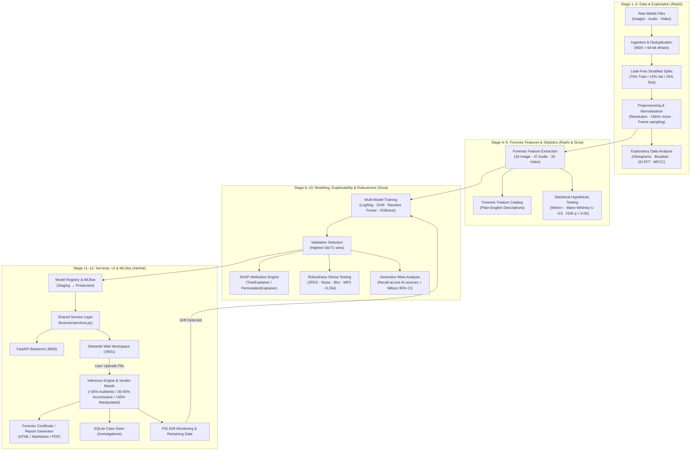
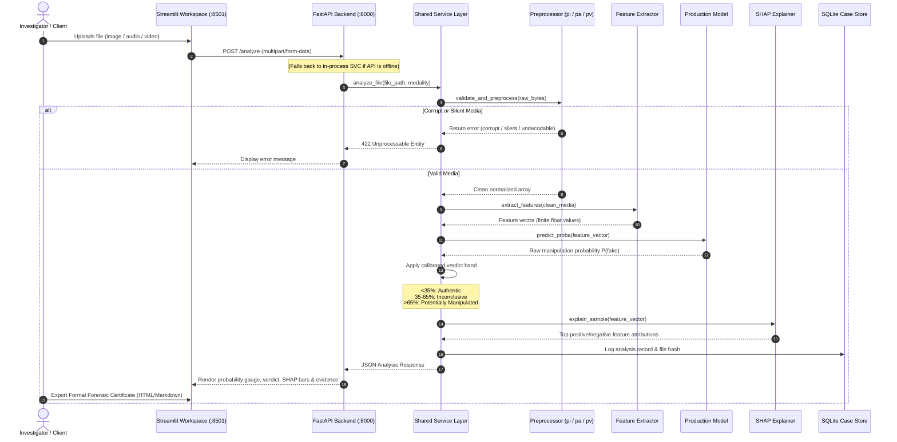

# ForensiX: Complete System Workflow & Execution Architecture

This document provides a comprehensive, step-by-step technical breakdown of the **ForensiX** end-to-end workflow, data flow, inference lifecycle, and MLOps operational loops.

---

## 1. High-Level System Architecture & Data Flow

The following diagram illustrates how raw inputs move through ingestion, feature engineering, statistical verification, modeling, explainability, deployment, and MLOps:



---

## 2. The Twelve-Stage Pipeline Lifecycle

ForensiX organizes its execution into twelve deterministic stages defined in `forensix/pipeline.py`. Each stage can be triggered individually or as a single end-to-end command (`make pipeline` or `forensix-pipeline`).

```bash
# Run the entire pipeline end to end
forensix-pipeline

# Or run stage by stage
forensix-pipeline ingest features eda stats train explain robustness generators summary
```

### Detailed Breakdown of the 12 Pipeline Stages:

```
[1. Ingest] ──> [2. Preprocess] ──> [3. EDA] ──> [4. Features] ──> [5. Stats] ──> [6. Train]
      │                                                                               │
[12. MLOps] <── [11. Deploy] <── [10. Generators] <── [9. Robustness] <── [8. Eval] <── [7. SHAP]
```

### Stage 1: Data Acquisition & Unified Ingestion
- **Module:** `forensix/data/dataset.py` | **CLI:** `make ingest` | **Owner:** Rashi Johari
- **Actions:**
  1. Recursively traverses raw file directories.
  2. Parses directory hierarchies to infer whether the sample is authentic or manipulated (`label = 0` or `1`) and identifies the generative source (e.g. `stable_diffusion`, `midjourney`, `elevenlabs`).
  3. Computes exact cryptographic MD5 hashes and perceptual difference hashes (64-bit dHash).
  4. Identifies duplicate and near-duplicate files (Hamming distance $\le 2$); retains only the primary exemplar and assigns `status = duplicate`.
  5. Partitions usable files into stratified 70% Train, 15% Validation, and 15% Test splits.
- **Output:** `artifacts/metadata.parquet` and dataset version registration in `artifacts/dataset_versions.json`.

### Stage 2: Multimodal Preprocessing & Data Hygiene
- **Module:** `forensix/preprocess/` | **CLI:** `make ingest` | **Owner:** Rashi Johari
- **Actions:**
  - **Images:** Rejects corrupt/unreadable files; standardizes to $256 \times 256$ via area/cubic interpolation; normalizes pixel channels to RGB float32 in $[0.0, 1.0]$.
  - **Audio:** Validates decoding; rejects silent files ($<-55\text{ dBFS}$) and clips $<0.5\text{ s}$; resamples to $16\text{ kHz}$ mono; strips DC offset; peak-normalizes to $0.95$; slices audio into uniform 4-second segments.
  - **Video:** Verifies streams with OpenCV; samples frames at fixed intervals (every 2nd frame up to 24 frames); resizes to $128 \times 128$; constructs consecutive frame pairs.

### Stage 3: Exploratory Data Analysis (EDA)
- **Module:** `forensix/eda.py` | **CLI:** `make eda` | **Owner:** Rashi Johari
- **Actions:**
  - Executes exclusively on the **training split** to prevent data snooping.
  - Computes class-conditional histograms and box plots for discriminative features.
  - Generates Spearman correlation heatmaps to reveal redundant features.
  - Computes mean 2D FFT radial power spectra, audio spectrograms/MFCCs, and inter-frame difference curves.
- **Output:** Visualizations in `reports/eda/<modality>/` and metrics in `summary.json`.

### Stage 4: Forensic Feature Extraction & Cataloging
- **Module:** `forensix/features/` | **CLI:** `make features` | **Owner:** Rashi Johari
- **Actions:**
  - Extracts **34 image features** (intensity entropy, RGB correlations, edge density, noise autocorrelation $h_1/v_1$, 2D FFT radial slope, DCT blockiness).
  - Extracts **47 audio features** (13 MFCCs mean/std, spectral centroid/rolloff/flatness/flux, zero-crossing rate, pitch mean/std/jitter, high-frequency energy ratios).
  - Extracts **33 video features** (temporal brightness/texture change, frame difference jerk, temporal noise correlation, optical-flow magnitude/coherence, motion-compensated warp error).
  - Maps every feature to human-readable explanations in `forensix/features/catalog.py`.
- **Output:** `artifacts/features_<modality>.parquet`.

### Stage 5: Statistical Hypothesis Testing & Validation
- **Module:** `forensix/stats/` | **CLI:** `make stats` | **Owner:** Sriza Goel
- **Actions:**
  - Performs Welch two-sample t-test (parametric), Mann-Whitney U test (non-parametric), and two-sample Kolmogorov-Smirnov test per feature on the train split.
  - Applies **Benjamini-Hochberg False Discovery Rate (FDR)** control across features; only features with FDR-adjusted $q < 0.05$ are considered statistically significant indicators.
  - Calculates Cohen's $d$ effect sizes and 95% confidence intervals of mean differences.
- **Output:** `reports/stats_<modality>.csv` and `reports/stats_<modality>.json`.

### Stage 6: Multi-Model Training & Model Selection
- **Module:** `forensix/models/train.py` | **CLI:** `make train` | **Owner:** Sriza Goel
- **Actions:**
  - Fits four candidate classifiers per modality:
    1. **Logistic Regression** (L2 regularization, wrapped in `StandardScaler`)
    2. **Support Vector Machine** (RBF kernel, wrapped in `StandardScaler`)
    3. **Random Forest** (Ensemble of bagged decision trees)
    4. **XGBoost** (Gradient boosted trees)
  - Evaluates candidates on the **validation split**. The model with the highest validation F1-score (ties broken by ROC AUC) is crowned the **Production Model**.
  - Logs hyper-parameters, cross-validation metrics, and weights to MLflow.
- **Output:** Saved model binaries in `models/<modality>_<model>.joblib`.

### Stage 7: Explainability Engine (SHAP)
- **Module:** `forensix/explain/` | **CLI:** `make explain` | **Owner:** Sriza Goel
- **Actions:**
  - Uses `TreeExplainer` for tree models (RF, XGBoost) and `PermutationExplainer` for linear/kernel models (LogReg, SVM).
  - Decomposes predictions into exact feature attribution contributions:
    $$\text{Prediction} = \text{Base Value} + \sum_{i} \phi_i$$
  - Groups contributions by indicator family (Frequency, Noise, Pitch, Motion, Spectral) and maps them to catalog descriptions.
- **Output:** SHAP summary plots in `reports/explain/` and explanation objects.

### Stage 8: Unbiased Test Evaluation
- **Module:** `forensix/models/train.py` | **CLI:** `make train` | **Owner:** Sriza Goel & Akshat Singh
- **Actions:**
  - Evaluates the production model strictly on the untouched **test split**.
  - Calculates Accuracy, Precision, Recall, F1-score, ROC AUC, Average Precision, Confusion Matrix, and generates ROC and Precision-Recall curves.
- **Output:** `reports/eval_<modality>.json` and `reports/model_comparison.csv`.

### Stage 9: Realistic Robustness & Degradation Stress-Testing
- **Module:** `forensix/robustness/` | **CLI:** `make robustness` | **Owner:** Sriza Goel
- **Actions:**
  - Tests models against real-world social media degradations:
    - **Image:** JPEG ($q=70, 30$), Gaussian blur ($\sigma=1, 2$), Gaussian noise ($\sigma=4, 10$), downscaling ($\times 0.75, \times 0.5$).
    - **Audio:** Background noise ($20\text{ dB}, 10\text{ dB SNR}$), MP3 re-encoding ($64\text{ kbps}, 32\text{ kbps}$), resampling ($11025\text{ Hz}, 8000\text{ Hz}$).
    - **Video:** H.264 compression ($\text{CRF } 28, 38$), spatial downscaling ($\times 0.75, \times 0.5$), frame rate reduction ($/2, /3$).
  - Reports clean F1 vs. degraded F1, absolute drop, and decodability failure counts (`n_failed`).
- **Output:** `reports/robustness_<modality>.csv` and degradation curves.

### Stage 10: Generator-Wise Consistency Analysis
- **Module:** `forensix/models/generators.py` | **CLI:** `make generators` | **Owner:** Sriza Goel
- **Actions:**
  - Evaluates manipulation recall for each known generative model (e.g. Stable Diffusion, Midjourney, TTS engines) with Wilson 95% confidence intervals.
  - Detects whether models overfit to one generative tool while failing on others.
- **Output:** `reports/generators_<modality>.json`.

### Stage 11: Deployment & Interactive Workstation
- **Module:** `api/` & `frontend/` | **CLI:** `make start` | **Owner:** Akshat Singh
- **Actions:**
  - Starts the FastAPI microservice on `http://localhost:8000` with interactive Swagger docs.
  - Launches the Streamlit forensic workstation on `http://localhost:8501`.
  - Supports 8 specialized UI views: **Analyze**, **Evidence**, **Compare**, **Forensic Lab**, **Investigations**, **Reports**, **Benchmarks**, and **MLOps**.

### Stage 12: Continuous MLOps Lifecycle & Retraining Gate
- **Module:** `forensix/mlops/` | **CLI:** `make monitor` / `make retrain` | **Owner:** Akshat Singh
- **Actions:**
  - **Experiment Tracking:** MLflow tracking of all runs, parameters, metrics, and models.
  - **Model Registry:** Lifecycle states: `staging` $\rightarrow$ `production` $\rightarrow$ `archived` / `rejected`.
  - **Drift Monitoring:** Computes **Population Stability Index (PSI)** between training feature distributions and incoming production samples.
  - **Retraining Gate:** When drift exceeds threshold ($\text{PSI} > 0.25$) or performance degrades, automated retraining is triggered. A candidate model is promoted **only** if its F1 on the untouched test set beats the current production model.

---

## 3. Real-Time Inference Workflow (Runtime)

When an investigator uploads a file in the **Analyze** view or sends a POST request to `/analyze`, the following synchronous sequence executes:



---

## 4. Dual-Execution Resilience: Client/Server vs. In-Process

ForensiX employs a resilient **dual-execution architecture**:

1. **Client/Server Mode (Microservice):**
   - The FastAPI backend runs as an independent daemon on `:8000`.
   - The Streamlit frontend calls the API via the typed Python SDK (`sdk/client.py`).
   - Enables horizontal scaling, headless CLI integrations, and external client API consumption.

2. **In-Process Fallback Mode (Zero-Dependency Standalone):**
   - If the FastAPI server is stopped or unreachable, the Streamlit frontend detects the connection failure and transparently imports `forensix.services` directly into its own Python process.
   - All analyses, SHAP explanations, case management, and reports function seamlessly without needing network ports or separate terminal windows.

---

## 5. Team Component Mapping in the Workflow

| Team Member | Direct Workflow Ownership | Inputs Consumed | Outputs Delivered |
|---|---|---|---|
| **Rashi Johari**<br>(2401030072) | **Stages 1, 2, 3, 4:** Data acquisition, deduplication, leak-free splits, image/audio/video preprocessing, 114 forensic features, forensic catalog, and EDA. | Raw media files in `data/raw/` | Clean `metadata.parquet`, `features_<modality>.parquet`, `catalog.py`, EDA plots in `reports/eda/` |
| **Sriza Goel**<br>(2401030094) | **Stages 5, 6, 7, 8, 9, 10:** Hypothesis testing, FDR control, 4 models training & validation selection, SHAP explainers, test evaluation, robustness stress tests, generator-wise analysis, and Forensic Lab sandbox. | Feature tables from Stage 4 | Trained models in `models/`, SHAP reports in `reports/explain/`, robustness benchmarks, statistical summaries |
| **Akshat Singh**<br>(2401030075) | **Stages 11, 12 & Full-Stack Core:** Dual-mode service layer, inference engine, calibrated verdict bands, FastAPI backend, client SDK, Streamlit workspace (8 views), case store, report builder, CI tests, and MLOps lifecycle (MLflow, registry, drift, retraining). | Models from Sriza, features from Rashi | Running API (`:8000`), Streamlit app (`:8501`), SQLite case database, MLOps registry & drift triggers, test suite |

---

## 6. How to Run Every Step of the Workflow

```bash
# 1. Install package and dependencies
make install

# 2. Generate small synthetic demo dataset (for instant offline testing)
make demo

# 3. Run the complete 12-stage pipeline
make pipeline

# 4. Launch both FastAPI backend (:8000) and Streamlit workspace (:8501)
make start

# 5. Open MLflow experiment dashboard
make mlflow

# 6. Run automated test suite verifying all modules
make test
```
